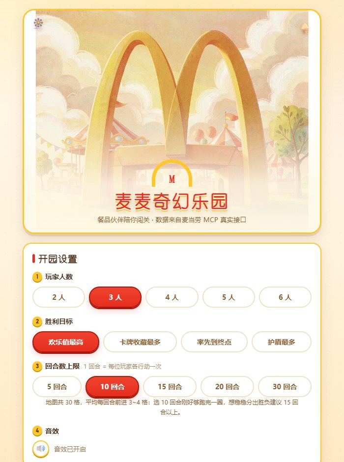
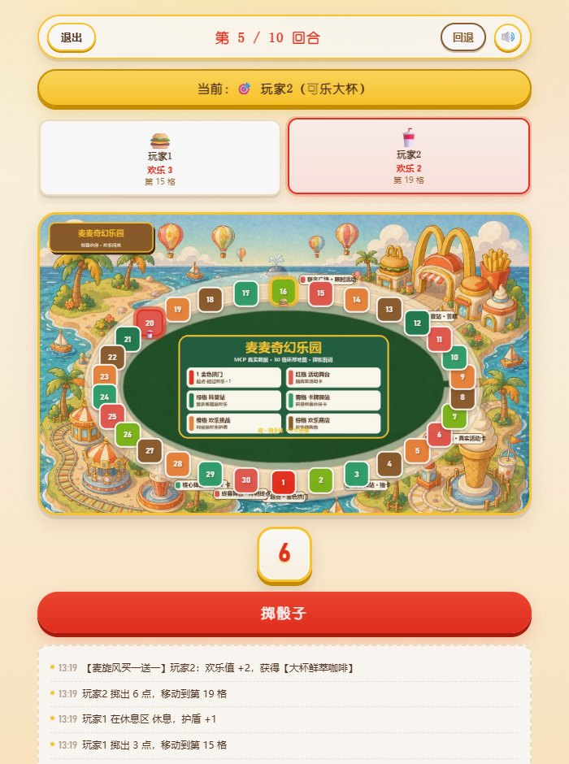
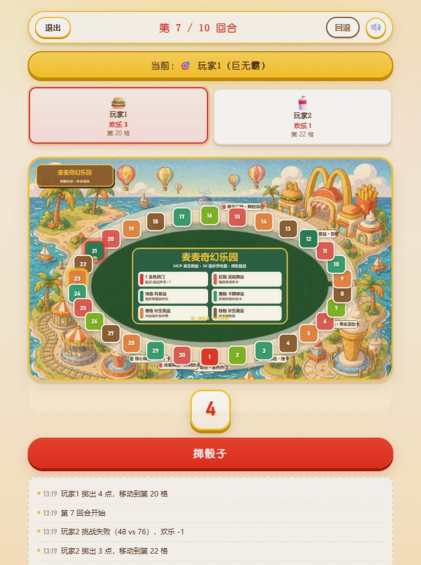
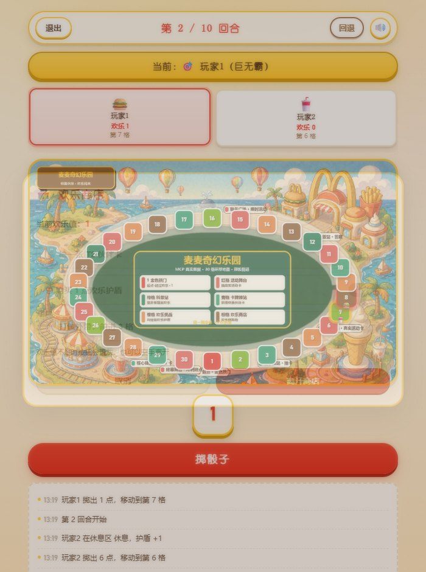
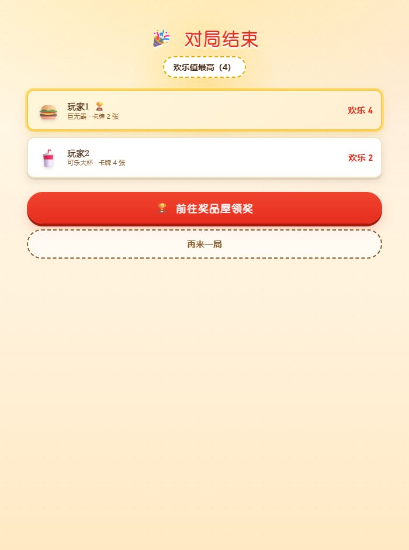
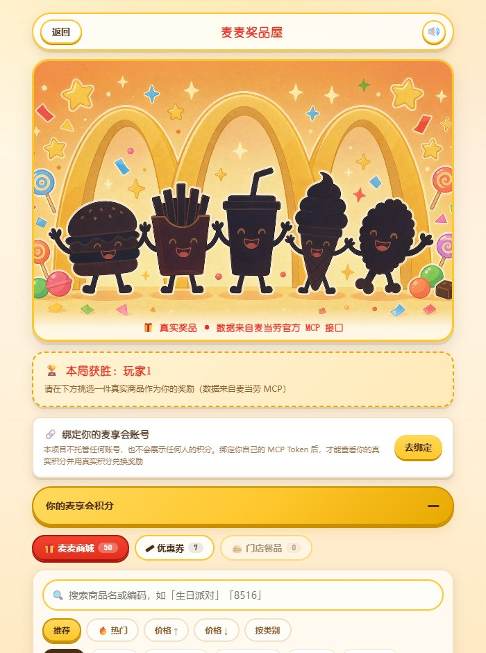
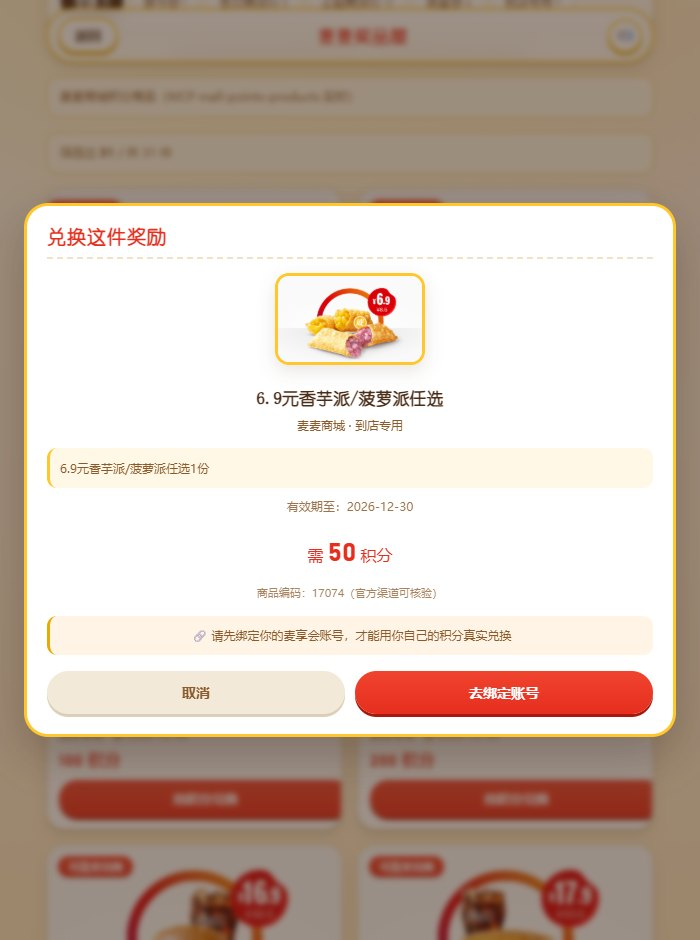
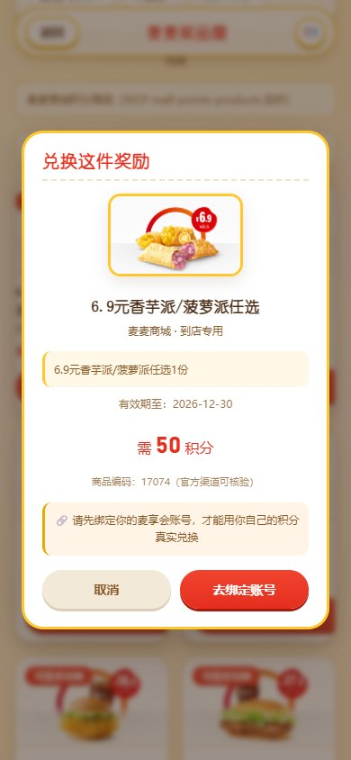

# 麦麦奇幻乐园 McD Arcade Adventure

> **以麦当劳餐品为角色的儿童乐园卡牌桌游**：卡牌属性由麦当劳 MCP 真实营养数据推导，事件卡来自当月真实营销活动，奖励直接对接麦麦商城的真实商品。

[](https://github.com/M-China/mcd-developer-innovation-challenge)
[](https://mcp.mcd.cn)
[](#)

<table>
<tr>
<td width="33%"></td>
<td width="33%"></td>
<td width="33%"></td>
</tr>
<tr>
<td align="center"><sub>① 开园设置</sub></td>
<td align="center"><sub>② 真实活动驱动的事件卡</sub></td>
<td align="center"><sub>③ 营养科普站（答案唯一）</sub></td>
</tr>
<tr>
<td width="33%"></td>
<td width="33%"></td>
<td width="33%"></td>
</tr>
<tr>
<td align="center"><sub>④ 欢乐商店</sub></td>
<td align="center"><sub>⑤ 回合用尽结算</sub></td>
<td align="center"><sub>⑥ 奖品屋（MCP 实时商品）</sub></td>
</tr>
<tr>
<td width="33%"></td>
<td width="33%"></td>
<td width="33%"></td>
</tr>
<tr>
<td align="center"><sub>⑦ 真实积分兑换（需绑定自己的账号）</sub></td>
<td align="center"><sub>⑧ 手机端奖品屋</sub></td>
<td align="center"><sub>⑨ 手机端对局：轮到谁写在按钮上</sub></td>
</tr>
</table>

**📦 源码**：https://github.com/banshoudigua/McD-Arcade-Adventure
（零依赖，`git clone` 后 `node scripts/start.js` 即可运行）

**🖐 不想装？直接在线玩**：**[https://mcd-arcade-adventure.app.workbuddy.host/](https://mcd-arcade-adventure.app.workbuddy.host/)**
（手机浏览器打开即可，多个孩子围一台手机轮流玩）

**30 秒本地体验**：克隆仓库 → `node scripts/start.js` → 打开 `http://127.0.0.1:3100` 即可开玩。
**不需要填 Token、不需要 npm install、没有账号体系。**

---

## 一、项目简介

小朋友在「麦麦奇幻乐园」中扮演见习小厨师，从 12 位餐品伙伴中挑选一位，
在 30 格环形欢乐地图上掷骰前进、抽取事件卡、挑战营养科普站、逛商店消费欢乐值、触发角色技能，
最后获胜者从 **MCP 实时拉取的真实麦当劳商品**中挑选奖励并生成可核验的兑换凭证。

**一句话**：把「查营养、查活动、查积分、查门店」四类查询型 MCP 接口，
编排成一个有输赢、有奖励、有知识输入的**家庭亲子游戏闭环**。

**玩法亮点**：
- **36 张事件卡**（12 张当月真实活动 + 24 张特色卡），支持位移/传送/夺取/再掷/换位/赌博/翻倍等 8 种效果，按稀有度加权抽取
- **角色技能真实生效**：12 张餐品卡各有专属技能（掷骰加成/战斗强化/负面抵消/每圈回复等），不是纸面文案
- **营养科普站**：从 160 条真实营养表生成**答案唯一**的判断题，答对加欢乐值，边玩边学
- **欢乐商店**：用欢乐值抽卡、买护盾、打包外带加速
- **奖励三选一**：麦麦商城商品 / 麦麦省优惠券 / 门店在售餐品，全部 MCP 实时数据，支持搜索、分类筛选与推荐/热门/价格/类别排序
- **真能兑换**：商城 50 件商品区分两类——24 件积分券可用**玩家自己的麦享会积分真实下单**（走官方 `mall-create-order`），26 件派对/读书会属付费活动；绑定账号后查看的都是**你自己的实时积分**，不含任何演示数字
- **零依赖、零资源文件**：不装任何 npm 包；14 种交互音效由 Web Audio 实时合成，仓库不引入任何 mp3/wav
- **离线可玩**：内置公开脱敏快照，无 Token 也能完整通关

---

## 二、目标用户

| 目标用户 | 他们得到什么 |
| --- | --- |
| **有 3~10 岁孩子的家庭** | 一局 10~20 分钟的亲子桌游。孩子为了抢巨无霸会主动去比较热量，店员带娃等餐时打开就能玩；全程不联网也能玩 |
| **麦当劳门店员工 / 兼职店员** | 等待、出餐高峰的碎片时间就是现成的对局。门店促销、麦麦省优惠券可以直接作为「奖励池」讲给顾客听 |
| **对营养教育感兴趣的家长** | 游戏内所有属性与题目都标注了真实 kcal 与蛋白质含量并可溯源，是一份带娱乐外壳的营养认知素材 |
| **独立开发者 / AI 应用探索者** | 一个零依赖、可直接改造成自己主题的 MCP 接入范例：MCP 代理层、快照降级、高危工具黑名单、BYOT 只读账号，全都给出了实现 |

**明确不适用**：任何需要真实交易下单的场景——本作品全程拦截真实扣款与下单（见 [安全边界](#安全边界)）。

---

## 三、四条真实数据主线

| 玩法 | MCP 工具 | 真实数据内容 |
| --- | --- | --- |
| **角色卡属性** | `list-nutrition-foods` | 160 条餐品营养数据，卡牌四维属性由真实热量/蛋白/脂肪/碳水推导 |
| **事件卡内容** | `campaign-calendar` | 当月真实营销活动，按关键词自动映射为 8 类游戏效果 |
| **营养科普站** | `list-nutrition-foods` | 基于真实营养表生成知识判断题，答案唯一 |
| **奖品屋** | `mall-points-products` + `available-coupons` + `query-nearby-stores`/`query-meals` | 50 件商城商品 + 7 张可领券 + 门店在售餐品，三类独立降级 |

以巨无霸为例（数据来源：`list-nutrition-foods` 实测返回）：

| 真实营养数据 | 换算的游戏属性 |
| --- | --- |
| 513 kcal | 力量 92 |
| 蛋白质 27g | 策略 62 |
| 脂肪 26g | 统率 88 |
| 碳水 42g | 欢乐 85 |

每张卡片底部都会标注其真实的 kcal 与蛋白质含量，可溯源、可验证。

### 事件卡示例

事件卡直接来自麦当劳当月真实活动，游戏内显示时会标注原始活动名称：

> 🎫 麦当劳 X PEACEMINUSONE
> 【联名惊喜派对】全体欢乐值 +2，并获得一张 T1 角色卡

### 营养科普站示例

棋盘第 11、20 格为科普站，系统会从真实营养表生成题目：

> **哪一份的「蛋白质」含量最高？**
> - 柠萌风味薄皮焦香 V 翅 → 18g ✅
> - 无糖可口可乐小杯 → 0g
> - 火腿扒早安营养卷 → 16g
> - 无糖可口可乐大杯 → 0g

题目选项数值**保证互不相同**，确保答案唯一（已通过 200 题自动化验证）。

---

## 四、如何玩（三种方式，任选其一）

本项目是**单机同屏**的卡牌桌游：几个孩子围着一台设备轮流掷骰，**不需要注册、不需要联机、不用一人一机**。
服务默认监听 `0.0.0.0`，所以下面三种方式都能玩。

### 方式 A：本机玩（最快，30 秒）

```bash
git clone https://github.com/banshoudigua/McD-Arcade-Adventure.git
cd <仓库目录>
node scripts/start.js
```

浏览器打开 `http://127.0.0.1:3100` 即可开玩。

### 方式 B：手机 / 平板玩（家里 WiFi 内，最实用）

**这是给孩子的推荐方式**——电脑开着服务，手机连同一个 WiFi 就能玩。

启动服务后，日志里会直接打印局域网地址：

```
════════ 麦麦奇幻乐园已就绪 ════════
  本机访问: http://127.0.0.1:3100

  📱 手机 / 平板访问（需与电脑连同一个 WiFi）：
     http://192.168.x.x:3100
══════════════════════════════════
```

手机浏览器输入那个地址即可。界面已针对手机竖屏适配，**掷骰按钮上直接写着当前玩家名字**，
下面是「下一位是谁」，小朋友自己就知道该谁掷、该把手机递给谁。

> 想固定地址不想每次查？连接手机热点时通常分配固定 IP，或在路由器里给电脑绑定 DHCP 保留地址。

### 方式 C：发布成公网在线应用（发给任何人玩）

项目是**单端口 HTTP 服务**（默认 3100，读 `PORT` 环境变量），可直接托管到任意支持 Node 的平台：

```bash
HOST=0.0.0.0 PORT=$平台分配端口 node backend/server.js
```

支持该模式的主流平台与要点：

| 平台 | 关键设置 |
| --- | --- |
| **WorkBuddy「发布为应用」** | 在 WorkBuddy 里对它说「**发布成在线应用**」，助手会调用内置发布能力，把本项目托管并生成一个对外 https 网址，拿到链接后任何人扫码/点开即可玩 |
| Railway / Render / Fly.io | Build 命令留空或 `npm ci`（本项目零依赖），Start 命令填 `node backend/server.js`，平台自动注入 `PORT` |
| 宝塔面板 / 自有服务器 | 反向代理到 `127.0.0.1:3100`，无需改代码 |

**在线部署注意事项**

- **不要上传 `.env`**：线上没有你的 MCP Token 时会自动回退仓库自带的公开脱敏快照，游戏依然可玩；
  想要线上数据也保持鲜活，只需在平台的环境变量里配 `MCD_MCP_TOKEN`（不要写进代码或仓库）
- **数据不出本机**指本地部署时的形态；公网部署时访问的是你自己的服务实例
- **真实兑换仍需玩家绑定自己的账号**：任何涉及个人积分与下单的操作都用玩家自己的 Token，服务端不托管凭证

### 已部署实例（可直接体验）

**[https://mcd-arcade-adventure.app.workbuddy.host/](https://mcd-arcade-adventure.app.workbuddy.host/)**

该实例部署时**未上传任何凭证**（发布目录已剔除 `.env` 与私有快照），
运行在**离线模式**——游戏功能完整：营养表、活动日历、商城商品、优惠券全部来自仓库内置的公开脱敏快照，
这些数据同样由麦当劳官方 MCP 实时拉取后脱敏而成。玩家绑定自己的 MCP Token 后，积分与兑换走实时接口。

### 参与这个项目（Fork / Star / 二开）

| 你想做的 | 怎么做 |
| --- | --- |
| 先玩一局 | 按上面方式 A/B 任选其一 |
| 分享给带娃的朋友 | 给仓库点一个 ⭐，或把 README 首屏截图发到家长群 |
| 改成自己的主题 | `game/characters.js` 换角色卡，`game/event-pool.js` 换事件卡，`web/assets/` 换美术，其余引擎逻辑不用动 |
| 接入自己的 MCP | `backend/reward-service.js` 改数据源，`backend/server.js` 调白名单 |
| 参与赛事排名 | 仓库必须设为 **Public**，Star 数是排名依据（详见第十二章「如何报名」） |

**如果这个项目对你有用，欢迎点 ⭐ 或 Fork。**

## 五、安装方法（开发者）

### 前置条件

**只有 Node.js 18+，没有别的。**

- 不需要 `npm install`（本项目零第三方依赖，`package.json` 里没有 `dependencies`）
- 不需要 MCP Token（不配置会自动回退仓库自带的公开脱敏快照，游戏可完整通关）
- 不需要注册账号、登录或手机号验证

### 30 秒跑起来

```bash
git clone https://github.com/banshoudigua/McD-Arcade-Adventure.git
cd <仓库目录>
node scripts/start.js
```

打开 **http://127.0.0.1:3100** 即可开玩。

> `start.js` 是幂等的：已在运行时直接输出地址，端口被占用会自动顺延到 3101、3102……
> 停止服务用 `node scripts/stop.js`，随时探测状态用 `node scripts/status.js`。

### 让数据「活」起来（可选，申请 MCP Token）

配置 Token 后，事件卡、奖品屋、营养题会全部走**麦当劳官方 MCP 实时接口**而非本地快照：

1. 手机号登录 https://open.mcd.cn/mcp
2. 点击右上角「控制台」→ 点击「激活」→ 同意服务协议 → 一键复制 Token
3. 在项目根目录创建 `.env`：

```bash
MCD_MCP_TOKEN=粘贴你的Token
```

重启服务即生效。**Token 只存在于你自己的 `.env`，该文件已被 `.gitignore` 排除，绝不会进入仓库。**

### 作为 WorkBuddy Skill 使用

本仓库**本身就是一个可安装的 WorkBuddy Skill**，根目录的 `SKILL.md` 即技能入口。
安装后让助手依次执行：

```bash
node scripts/status.js   # 探测，RUNNING 时输出 SKILL_URL
node scripts/start.js    # 启动服务
node scripts/stop.js     # 停止服务
```

助手会把 `http://127.0.0.1:3100` 直接呈现给用户游玩，数据不出本机、无需公网部署。

### 可用接口

| 接口 | 说明 |
| --- | --- |
| `GET /api/events` | 事件卡组：真实活动 + 内置特色卡（36 张，含 8 种效果类型） |
| `GET /api/rewards` | 奖励商品聚合：麦麦商城 + 优惠券 + 门店餐品（MCP 实时，自动降级快照） |
| `GET /api/nutrition-question?player=玩家1` | 营养科普题目（答案唯一） |
| `GET /api/snapshot` | 本地数据快照 |
| `POST /api/mcp/:toolName` | MCP 白名单工具代理（11 个只读工具） |

### 开发者命令

```bash
node backend/pull-mcd-data.js     # 重新拉取 MCP 真实数据生成快照
node backend/sanitize-snapshot.js # 生成脱敏快照（开源提交前必做）
npm test                          # 引擎 39 项 + 前端模拟 14 项断言
npm run test:e2e                  # 真实浏览器端到端 50 项（需先启动服务）
node tools/center_character_images.py  # 角色头像自动居中（图片资产工具）
```

---

## 六、使用示例

### 示例一：家庭亲子局（3 人 · 10 回合 · 欢乐值最高）

```
① 开园设置        选择 3 人 / 胜利目标「欢乐值最高」/ 10 回合
② 选卡            依次点选巨无霸、麦辣鸡腿堡、可乐大杯（人物数 = 玩家数）
③ 掷骰            轮流点击「掷骰子」，落格触发事件 / 商店 / 科普站 / 挑战
④ 结算            回合用尽后按欢乐值排名，第一名进入奖品屋
⑤ 领奖            在真实商品中挑一件 → 生成含商品编码的兑换凭证 → 到官方渠道兑换
```

一次典型对局日志（真实运行输出）：

```
乐园开园，3 位见习小厨师就位
玩家1 掷出 5 点，移动到第 5 格
【元气早餐时光】玩家1：欢乐值 +2
玩家1 掷出 4 点，移动到第 9 格
【薯条撒了一地】玩家2：后退 2 格
⚡ 麦香鱼【海鲜洞察】重抽一次事件
玩家3 答对营养题【柠萌风味薄皮焦香 V 翅】，欢乐值 +2
🏪 玩家1 进入欢乐商店，花 3 欢乐值购入伙伴卡【麦旋风】
```

### 示例二：双人快局（2 人 · 15 回合 · 率先到终点）

30 格地图平均每回合前进 3~4 格，**15 回合可让「率先抵达终点」真正达成**（实测输出）：

```
🎉 对局结束
率先抵达终点（1 圈）
🏆 本局获胜：玩家1
```

### 示例三：查看自己的真实麦享会积分（可选）

奖品屋顶部点「绑定我的账号」→ 粘贴自己的 MCP Token →
显示**实时**积分。Token 只存浏览器 `sessionStorage`，服务端零存储；无效 Token 自动回退演示数据。

### 示例四：调接口直接取奖品列表

```bash
curl http://127.0.0.1:3100/api/rewards | head -c 400
```

```json
{
  "success": true,
  "rewards": {
    "mall": { "source": "mcp", "items": [{ "name": "麦当劳亲子读书会", "catName": "读书会", "price": "45", "spuId": 1830 }] },
    "coupons": { "source": "mcp", "items": [{ "name": "巧克力味厚松饼猪柳蛋套餐" }] }
  }
}
```

---

## 七、项目结构

```text
mcd-arcade-adventure/
├── SKILL.md                     # WorkBuddy 技能入口（本仓库即一个可安装的 Skill）
├── scripts/                     # 技能启停脚本
│   ├── start.js                 # 启动游戏服务（前台常驻）
│   ├── stop.js                  # 停止服务（pid 优先，否则按端口查杀）
│   └── status.js                # 探测服务状态与可访问地址
├── AGENTS.md                    # 项目规则文件
├── 参赛设计方案.md                # 需求与设计方案
├── CONTEST_DECLARATION.md       # 参赛声明（官方原文，内容不可改）
├── MCP_INTEGRATION.md           # MCP 接入说明（Server/Tool/调用流程/业务价值）
├── workbuddy.md                 # WorkBuddy 开发对话上下文（核验联动奖励）
├── DEV-CONVERSATION.md          # 完整开发对话留档
├── images/                      # README 展示截图
├── .env                         # MCP Token（已被 .gitignore 忽略，勿提交）
├── .env.example                 # 凭证模板
├── data/
│   ├── mcd-snapshot.json         # MCP 真实数据快照（含隐私，不提交）
│   └── mcd-snapshot.public.json  # 脱敏版快照（开源提交用）
├── backend/
│   ├── mcp-client.js            # MCP 客户端（鉴权、节流、日志）
│   ├── pull-mcd-data.js         # 数据拉取脚本
│   ├── campaign-parser.js       # 真实活动解析器（DSL → 结构化事件卡）
│   ├── reward-service.js        # 奖励聚合（商城/优惠券/门店餐品）
│   ├── sanitize-snapshot.js     # 快照脱敏脚本
│   └── server.js                # HTTP 服务 + MCP 代理 + 安全白名单
├── game/
│   ├── engine.js                # 桌游状态机（Node 端，30 格棋盘）
│   ├── characters.js            # 12 张角色卡数据（带 MCP 溯源标记）
│   ├── event-pool.js            # 24 张内置特色事件卡 + 8 种效果类型
│   └── nutrition.js             # 营养科普题生成器（保证答案唯一）
├── web/
│   ├── index.html               # 单页应用骨架
│   ├── styles.css               # 视觉规范（复古游乐园票券风，麦当劳金 + 快乐红，无紫色）
│   ├── app.js                   # 前端逻辑 + History API 路由
│   ├── sound.js                 # 音效系统（Web Audio 实时合成，零音频文件）
│   └── assets/                  # AI 生成插画（hero/map/banner/characters 12 张）
├── tools/
│   ├── generate_mcd_map.py      # 环形地图生成（程序绘制 30 格与前端坐标一致）
│   └── center_character_images.py # 角色头像自动居中 + 尺寸归一化
└── test/
    ├── engine.test.js           # 引擎 39 项断言
    ├── frontend-sim.test.js     # 前端模拟 14 项（DOM stub 真实执行 app.js）
    ├── e2e-flow.js              # 真实浏览器端到端 50 项（playwright-core）
    └── flow.test.js             # 早期流程用例（保留）
```

---

## 八、技术亮点

### 1. History API 路由与对局状态回退
- 使用 `pushState` / `replaceState` / `popstate` 管理路由
- 对局状态存入 `sessionStorage`，浏览器前进/后退可恢复上一局面
- 内置「回退」按钮，最多保留 30 步历史快照

### 2. MCP 真实数据驱动
- 开发期预拉取生成快照（解决限流与首屏速度）
- 运行时经后端代理直连 MCP（保证数据鲜活）
- 快照兜底 + 实时拉取的「双轨」设计

### 3. 真实活动驱动事件卡
`campaign-calendar` 返回的是自定义 DSL 文本，`campaign-parser.js` 负责解析：
- 提取活动标题、内容介绍、配图 URL、日期分组
- 按关键词（「联名」「派对」「早餐」「新品」等）自动匹配游戏效果
- 区分「进行中 / 未来 / 往期回顾」，往期活动自动排除
- 解析失败时降级为内置卡组，保证游戏始终可玩

### 4. 营养科普的答案唯一性保证
营养题从 160 条真实营养数据中抽取，**先按指标数值分组再随机**，确保 4 个选项数值互不相同。这解决了直接随机抽样会出现的并列问题（如两杯饮品都是 167 kcal），已通过 200 题自动化验证。

### 5. AI 辅助美术

| 文件 | 用途 | 生成方式 |
| --- | --- | --- |
| `web/assets/hero.jpg` | 首页乐园主视觉 | AI 生成 |
| `web/assets/board.jpg` | 棋盘纸质底纹 | AI 生成 |
| `web/assets/banner.jpg` | 奖品屋横幅 | AI 生成 |

图片经 JPEG 压缩（体积节省 87-95%）与水印裁切处理。**卡牌与奖品坚持使用 MCP 接口返回的真实商品图**，不使用 AI 生成，以保持数据可信。

### 6. 安全白名单机制
**Token 只存在于服务端，浏览器端永远拿不到。**

| 类别 | 工具 | 处理 |
| --- | --- | --- |
| 只读查询（11 个） | `list-nutrition-foods`、`campaign-calendar`、`now-time-info` 等 | 白名单放行 |
| 高风险写入 | `create-order`、`mall-create-order`、`auto-bind-coupons`、`cancel-order`、`draw-lottery` | **服务端硬拦截** |
| 未列入白名单 | 其他工具 | 一律拒绝 |

兑换流程强制二次确认，程序不会自动执行任何扣款或扣积分操作。

---

## 九、玩法说明

- **玩家人数**：2-6 人
- **胜利目标**：欢乐值最高 / 卡牌收藏最多 / 率先抵达终点 / 护盾最多
- **回合上限**：5-30 回合（默认 10，1 回合 = 每位玩家各行动一次；地图 30 格，10 回合约跑完一圈）
- **棋盘**：30 格循环，含金色拱门、欢乐商店、欢乐挑战、活动舞台、卡牌驿站、休息区
- **卡牌**：12 张餐品角色卡，分T1/T2/T3 三档稀有度
- **事件卡**：36 张（12 张真实活动 + 24 张特色卡），8 种效果类型按稀有度加权抽取

---

## 十、开发规范

本项目严格遵守以下规范：

- 零 `try/catch`，统一使用 callback 风格，错误走Promise 双通道
- 零 `.catch()`，网络与存储异常统一在 `.then(res, rej)` 中处理
- 配色仅使用麦当劳金 `#FFC72C`、快乐红 `#E62E1E`，**不使用紫色或紫蓝色**
- 关键路径均带中文注释
- 异常环节均输出`console` 调试信息，便于定位

---

## 十一、安全边界

这是一个面向儿童的作品，**任何真实交易行为都在代码层被拦截**，而非仅靠文档承诺。

| 风险点 | 代码级处理 |
| --- | --- |
| **拿项目 Token 替人下单** | 任何个人数据与写入类工具**必须 BYOT**（玩家自己的 Token），用项目 Token 调用一律 401 |
| **误触扣积分** | 真实兑换必须满足三个条件：玩家自己的 Token + 界面上勾选确认 + 请求体 `confirm:true`，服务端缺一即拒 |
| 无效 Token | 返回 **401** 而非回落到项目 Token——否则等于拿开发者账号替别人扣分 |
| 代点餐 / 代领券 / 抽奖 / 取消订单 | `create-order`、`cancel-order`、`auto-bind-coupons`、`party-order-create`、`draw-lottery` **永久 403**，与游戏兑奖无关且风险过高 |
| `create-order` 的 `withOrder` | 强制置为 `false`，只做试算 |
| 用户账号凭证 | 仅奖品屋可粘贴自有 Token（BYOT），存浏览器 `sessionStorage`，**服务端零存储、零落库、日志脱敏** |
| Token 进入仓库 | `.env` 被 `.gitignore` 排除；对外文档只写 `YOUR_MCP_TOKEN` 占位符 |
| 奖励凭证 | 记录「谁选了哪件商品 + 商品编码 + 官方领取三步」；**真实兑换走玩家自己的 Token 真实下单**，凭证仅作游戏内凭据 |
| 无效 Token | 服务端返回 **401**（而非笼统 500），前端可区分「Token 错」与「服务挂了」 |

---

## 十二、赛事合规说明

| 官方要求项 | 对应文件 | 状态 |
| --- | --- | --- |
| 项目介绍 / 安装方法 / 使用示例 / 目标用户 | `README.md`（第一~五章） | ✅ |
| 参赛声明（内容不可改） | [`CONTEST_DECLARATION.md`](CONTEST_DECLARATION.md) | ✅ 官方原文，MD5 校验一致 |
| MCP Server / Tool / 调用流程 / 业务价值 | [`MCP_INTEGRATION.md`](MCP_INTEGRATION.md) | ✅ 含第八章调用流程、第九章业务价值 |
| 源代码 / 可运行内容 | 本仓库 | ✅ 零依赖，`node scripts/start.js` 即跑 |
| WorkBuddy 开发对话上下文 | [`workbuddy.md`](workbuddy.md) | ✅ 用于核验联动奖励 |

其他合规项：

- **完整开发对话留档**：[`DEV-CONVERSATION.md`](DEV-CONVERSATION.md)（20 轮对话，持续追加中，未事后补写）
- **非商业用途**：不含任何内购、付费、广告或引流内容
- **无官方背书**：见 `CONTEST_DECLARATION.md`「使用提示」章节
- **商标使用**：不使用麦当劳官方 Logo 作主视觉，商标仅作描述性指代

---

## 十三、如何报名

本项目已按官方格式提交报名 Issue。若需复现报名流程：

1. 将仓库设为 **Public**（报名条件之一）
2. 在 [官方仓库](https://github.com/M-China/mcd-developer-innovation-challenge) 新建 Issue，正文严格使用以下格式：

```
【参赛申请】
项目名称：麦麦奇幻乐园 McD Arcade Adventure
项目地址：https://github.com/banshoudigua/McD-Arcade-Adventure
项目简介：<一句话简介>
```

⚠️ 官方提示的三个易错点：

- 报名 Issue 的**标题与正文之间不要使用换行符**
- **项目地址不要用 Markdown 链接格式**
- 正文**不超过 1000 字**，且**不要携带图片**

**关键时间（北京时间）**

| 阶段 | 时间 |
| --- | --- |
| 报名及排名 | 2026-10-09 10:30 ~ **2026-10-25 23:59** |
| 定榜 | 2026-10-26 00:00 |
| 收货信息提交截止 | 2026-11-14 |

> 排名按**公开 Star 数**，Star > 0 才进榜，排行榜展示前 100。
> 欢迎 Star ⭐ 支持，也可以把这个项目推荐给带娃的朋友。

## 十四、参考与致谢

桌游引擎设计思路参考了本地项目 `冰橙星星乐 - 三国篇 - 起源`的状态机与数据模型（30 格循环棋盘、`effect_rules` 结构化结算、主题数据分层）。代码为Web 形态全新实现，未直接复制原项目数据与美术资源。

---

## 十五、许可

本项目仅供学习交流与非商业演示使用。麦当劳及相关商标归其权利人所有，本项目与麦当劳中国无任何隶属或背书关系。